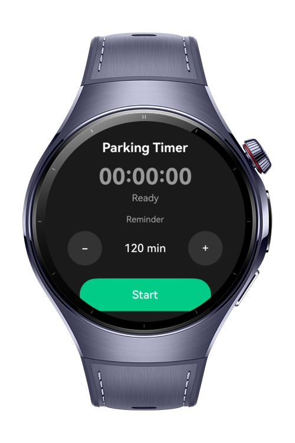
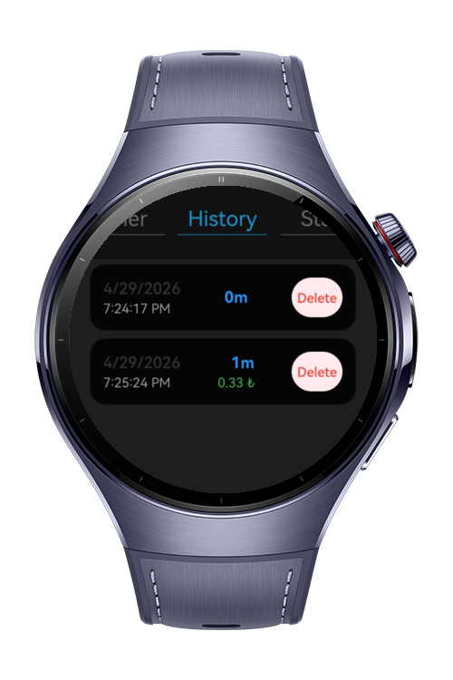
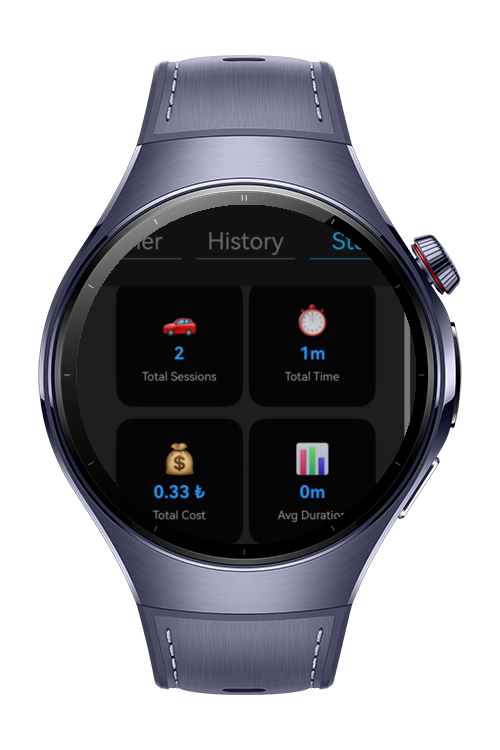

# Parking Timer

A comprehensive parking management app for wearable devices featuring GPS location tracking with auto-saved addresses, built-in cost calculator for hourly rates, complete parking history with detailed statistics, smart countdown timer with customizable durations, and a modern dark mode interface optimized for OLED displays. Built with MVVM architecture, it tracks your parking sessions, calculates total expenses, identifies frequently used locations, and stores everything locally with zero internet dependency except for address lookups—all while maintaining maximum 16px fonts for optimal readability on small screens.

# Preview

<p align="left">
  
  
  
  
</p>

# Use Cases

* **Smart Timer** - Set parking duration (30min - 8hrs) with real-time countdown
* **Cost Calculator** - Enter hourly rate, see estimated and actual costs
* **Parking History** - View all past sessions with date, time, location, and cost
* **Statistics** - Track total sessions, hours parked, money spent, favorite spots
* **Dark Mode** - Battery-efficient OLED-optimized interface (max 16px fonts)
* **Offline Storage** - All data saved locally, works without internet

# Tech Stack

- **Languages**: ArkTS, Typescript
- **Frameworks**: HarmonyOS SDK 5.1.0(18)
- **Tools**: DevEco Studio Vers 5.1.0.842
- **Libraries**: @kit.BasicServicesKit, @kit.NotificationKit

# Directory Structure

```
entry/src/main/ets/
├───entryability
│       EntryAbility.ets
├───entrybackupability
│       EntryBackupAbility.ets
├───models
│       ParkingRecord.ets
├───pages
│       Index.ets
├───services
│       StorageService.ets
├───viewmodels
│       ParkingViewModel.ets
└───
```

# Constraints and Restrictions

## Supported Devices

- Huawei Watch 5

# LICENSE

Parking Timer is distributed under the terms of the MIT License.
See the [LICENSE](/LICENSE) for more information.