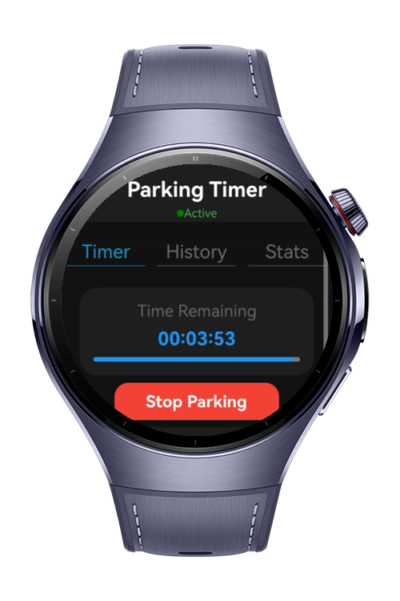

> **Note:** To access all shared projects, get information about environment setup, and view other guides, please visit [Explore-In-HMOS-Wearable Index](https://github.com/Explore-In-HMOS-Wearable/hmos-index).

# Parking Timer

A simple and practical wearable application that helps users track their parking duration and receive timely reminders.
The app features a clean, minimalist interface with a real-time elapsed time counter and customizable reminder settings.
Users can start and stop parking sessions with a single tap, set reminder intervals from 30 to 480 minutes, and receive
notifications when their parking time is about to expire. The dark-themed interface is optimized for wearable devices
with circular displays.

# Preview

<p align="left">
  
  
</p>

# Use Cases

Ideal for drivers who need to monitor parking time limits in metered zones, parking garages, or time-restricted areas.
Perfect for preventing parking tickets by providing advance warnings before time expires. The wearable format allows
users to check remaining time and receive notifications directly on their wrist without having to take out their phone.
Suitable for daily commuters, shoppers, and anyone who frequently parks in time-limited spaces and wants a convenient
way to avoid overstaying.

# Tech Stack

- **Languages**: ArkTS, Typescript
- **Frameworks**: HarmonyOS SDK 5.1.0(18)
- **Tools**: DevEco Studio Vers 5.1.0.842
- **Libraries**: @kit.BasicServicesKit, @kit.NotificationKit

# Directory Structure

```
entry/src/main/ets/
├───entryability
│       EntryAbility.ets
├───entrybackupability
│       EntryBackupAbility.ets
├───pages
│       Index.ets
└───
```

# Constraints and Restrictions

## Supported Devices

- Harmony OS Next Phone

# LICENSE

Parking Timer is distributed under the terms of the MIT License.
See the [LICENSE](/LICENSE) for more information.